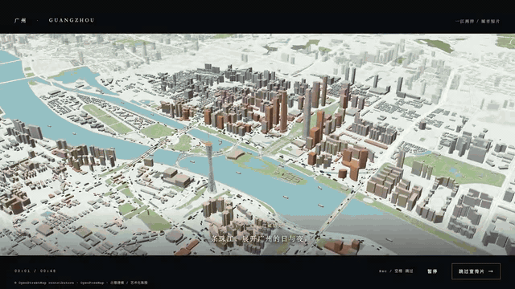
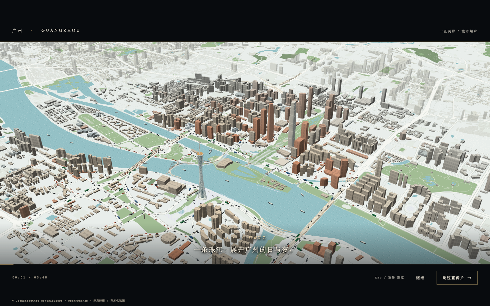
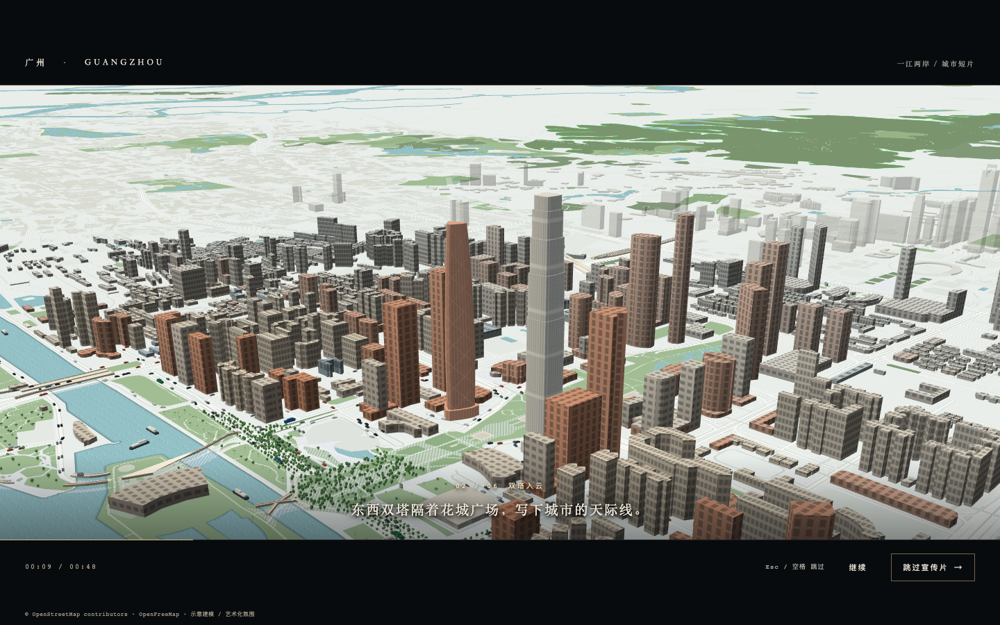
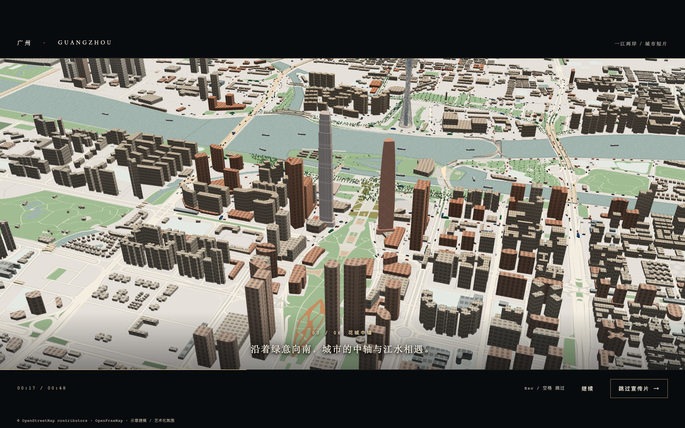
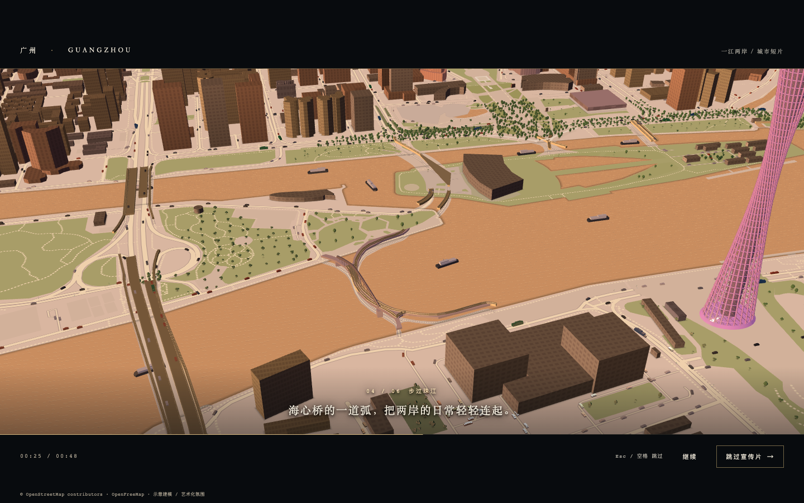
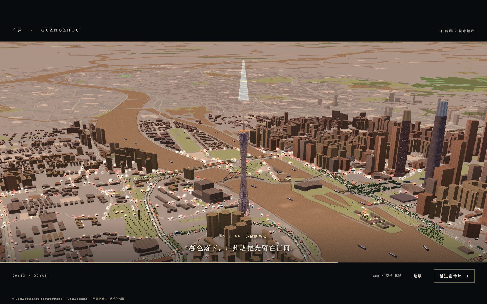
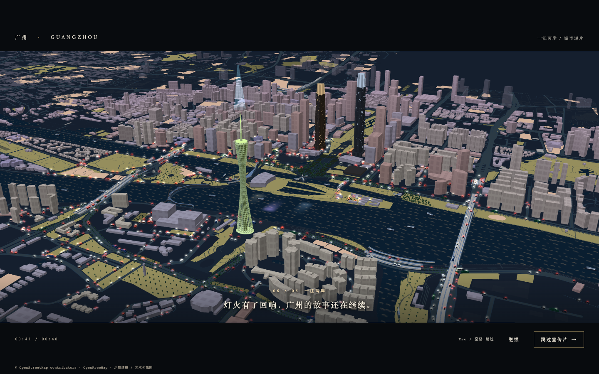

# 街区切片 · 广州塔与珠江

广州塔周边 **3 公里**的实时三维街区：一个场景、两条渲染路径——默认走 MapLibre 现版，`?engine=three` 挂 three.js 那一套。点击楼块查它在 OpenStreetMap 里的用途与高度来源，按楼名或「街道 + 门牌」检索后直接飞过去，「城市透视镜」按用途与高度分档筛选，白昼／日落／夜景三档氛围，八站镜头导览，外加一段 48 秒城市短片。



- 广州塔（现版，MapLibre GL JS）：`http://127.0.0.1:5174`
- 同一份数据的新引擎（three.js）：`http://127.0.0.1:5174/?engine=three`
- 48 秒城市短片：`http://127.0.0.1:5174/?film=1`（自动进片）

技术栈 Vite 8 + MapLibre GL JS 6 + three.js，无前端框架。底图与建筑数据来自 OpenFreeMap 与 OpenStreetMap（ODbL-1.0），不需要 API key，也不接入追踪。

## 宣传片

六幕、共 48 秒：白昼的珠江两岸 → 日落的花城中轴 → 小蛮腰亮起的夜景。1280×720、无音轨；页面里点顶栏「播放宣传片」，离线看完整正片见 [`docs/film/guangzhou-film.mp4`](docs/film/guangzhou-film.mp4)（GitHub 不内嵌仓库里的 mp4，只能下载）。

| 01 江城初见 · 白昼 | 02 双塔入云 · 白昼 | 03 花城中轴 · 日落 |
| --- | --- | --- |
|  |  |  |
| 04 步过珠江 · 日落 | 05 小蛮腰亮起 · 夜景 | 06 一江两岸 · 夜景 |
|  |  |  |

## 能做什么

- **点楼块看来历**——点快照内任一可见楼块或塔身，看它的用途、高度及高度来源（OSM 标注／按层数估算／高度未知）、占地、地址与建成年份，并附 OpenStreetMap 原始页面。没有名称的楼明确写「未标注名称」，不按位置或高度编造名字；圈外只作背景的灰色体块不可点。
- **楼名与地址检索**——楼名、英文名或「街道 + 门牌」，五档排序（中文名前缀 → 英文名前缀 → 中文名包含 → 地址前缀 → 地址或英文名包含），`↓`/`↑` 选行、`Enter` 打开、`Esc` 分两步退出。
- **城市透视镜**——用途筛选 × 高度五档（[0,20) / [20,60) / [60,100) / [100,200) / 200+ 米）× 来源开关。统计覆盖整个 3 公里快照，不随视口移动或缩放变化；高度未知的楼只画灰色平面，不进任何数值分布，但照样能点。
- **周边地点**——按需展开 3 公里内的餐饮、游览、出行与购物地点，最多显示最近 200 处；加载失败有「重新加载地点」，不阻塞地图。
- **三档氛围**——白昼／日落／夜景同步切换天空、江面、道路、建筑配色与塔身灯光，图例与面板跟着换色。是艺术化氛围，不是实时天气、真实日照或照明模拟。
- **八站镜头导览**——广州塔 → 海心桥 → 花城广场 → 广州图书馆 → 广东省博物馆 → 广州西塔 → 广州东塔 → 猎德大桥，每站一句介绍、到站停 7 秒，可暂停、前后切站或退出。导览的是镜头，不提供步行路线。
- **视角分享**——地址栏就是当前镜头与选中楼块的链接，复制即分享，打开后按当时的角度复现并重新打开那张卡片。镜头与选中要素各自独立校验：非法参数只忽略自己那部分，不夹紧、不丢弃整条链接。
- **另一种引擎**——`?engine=three` 用 three.js 通过 MapLibre 的 CustomLayer 共享同一个 WebGL2 上下文与深度，读同一份数据，取景与手势读数对齐。

**操作**：左键拖动只平移；旋转用 **⌥/Alt 加左键拖动**（横向 100 像素约 20°、纵向 100 像素约 25°），鼠标也可右键拖动或 ⌃/Ctrl 加左键拖动；滚轮缩放，手机双指。首屏「看全范围」切俯视总览（虚线圈＝半径 3 公里），「回到广州塔」回近景，「环绕」绕固定塔址旋转。系统开启「减少动态效果」时，过渡动画与自动播放自动取消。

## 本地运行

需要 Node.js 22.12+ 或 24+。

```bash
npm install
npm run dev       # http://127.0.0.1:5174；端口被占用直接报错，不漂到别的地址
```

推荐 Chrome 并开启图形加速。地图瓦片与按需查询的地点需要联网；建筑快照随项目提供，不必每次向 Overpass 请求上万条几何。

```bash
npm test          # Node 单元测试
npm run build     # 生产产物在 dist/
npm run preview   # http://127.0.0.1:4173
```

当前主包 **1,661.50 kB / gzip 447.29 kB**，样式 **114.32 kB / gzip 17.37 kB**，另有 **508.48 kB Worker**；Vite 的大包提醒没有隐藏。建筑快照 **1,660,823 字节 / gzip 275,979 字节**，检索索引 **124,017 字节 / gzip 20,161 字节**（首次打开搜索才下载），塔轮廓 **1,450 字节**。静态数据按需加载、不打进 JS 主包，部署服务器需自行开启压缩。

## 数据与边界

- **底图**：`https://tiles.openfreemap.org/styles/liberty`，OpenFreeMap 的 OSM 矢量瓦片；保留 OpenFreeMap / OpenStreetMap 署名。
- **圈内建筑**：`public/data/canton-buildings.geojson`，源数据时间戳 **2026-09-20T01:15:35Z**，ODbL-1.0。原始 5 公里 Overpass 缓存含 10,349 个闭合 way，按 `RADIUS_METERS = 3000` 筛成 **3,990 个建筑/部件要素**——这是要素数，不是 3,990 栋独立建筑。快照不含 relation，也不保证覆盖现实中所有建筑。
- **卡片只读白名单标签**：`name` / `name:en`、`building` / `building:part` 类型、单个场所标签、`addr:street` / `addr:housenumber`、`start_date`。3,990 个要素里 **624 个有名称**、85 个有街道地址；`description`、`operator` 等自由文本不进快照，卡片全部按 `textContent` 渲染。不会根据名称、位置或高度猜用途。
- **分类**只读明确的 `building` / `building:part` 标签：商业办公 **282**、住宅 **1,415**、公共设施 **236**、未分类 **2,057**。「公共设施」表示设施类型，不表示公有产权或免费开放。
- **高度来源分三档**：**54** 个有 OSM `height` 标注（不是测绘或实测认证）、**1,016** 个按层数 × 3.2 米换算、**2,920** 个高度未知。未知项在普通模式下按轮廓短边取 **9.6–24 m 的沙盘示意厚度**，仅作体块示意、不是高度估计；墙面另叠一层程序生成的窗格贴图（约 7.4 m 一条带），只作立面节奏，不代表真实楼层或窗数；夜景的示意灯窗按各自 OSM id 取余分档，不做手工摆点，也不代表入住率。
- **塔址**：场景与全部 3 公里查询统一校正到 **23.10900, 113.31913（WGS 84）**，取自广州塔 `way/584204634` 轮廓中心附近；随附需求里的 `23.10660, 113.32450` 距真实轮廓约 610 米，没有采用。
- **塔**：`public/data/canton-tower.geojson` 保存 `way/584204634` 的真实轮廓与名称、地址、建成年份，只作不透明度 0 的 450 米命中体和卡片来源。塔身是参数化示意模型（约 450 米塔身加桅杆至 600 米），外形、构件尺寸与材质作简化，不能用于建筑测量；塔身作为独立参照保留，不计入分类、来源与高度分档统计。
- **检索索引**：`canton-buildings-index.json` 由快照派生，共 **638 条**（有名称或有地址的楼块去重后 637 条，另加塔身一条）。纯前端字符串比较，不索引几何坐标、不引入模糊匹配或第三方检索库。
- **导览落点**：静态地理坐标。海心桥 `way/1313608038`、花城广场 `way/243319596` 于 2026-09-22 用一次 Overpass 查询核对，坐标为返回的外接框中心而非测绘点；广州图书馆 `way/240896441` 用索引里的轮廓内部锚点；2026-10-16 新加的广东省博物馆、广州西塔、广州东塔、猎德大桥逐位读 `src/landmarks.js` 那张地标表——名牌、卡片与镜头读的是同一份坐标，手打一个数就会对不上。
- **周边地点**：主接口是 `maps.mail.ru` 的 Overpass，备用 `overpass-api.de`；POST 表单、30 秒超时、同查询并发合并、内存缓存、失败不缓存，429 不连续请求备用实例。公共服务偶有超时或 504，可用性不作保证；距离是球面直线距离，不是步行距离。
- **不做的事**：不获取用户定位、不接入追踪、不接收费 API、不做 AI 重建、不做路线规划。浏览地图会向瓦片服务发送视野请求，首次打开地点面板会向公共 Overpass 发送固定塔址，首次打开搜索只下载本站的静态索引。
- **撤销路径**：逐项的成组撤销入口（半径、透视镜、氛围、导览等）写在 [`DEVELOPMENT.md`](DEVELOPMENT.md)。

## 重新抓取建筑快照

需要重新抓取时，用上面的 Overpass 端点执行这条 **3 公里**查询，把完整 JSON 存到本地，检查没有 `remark` 后再转换（不要高频请求）：

```text
[out:json][timeout:180][maxsize:536870912];
(way[building](around:3000,23.10900,113.31913);
 way["building:part"](around:3000,23.10900,113.31913););
out geom;
```

```bash
node scripts/prepare-buildings.mjs /绝对路径/overpass-response.json
npm test
```

脚本同时输出 `canton-tower.geojson` 与检索索引，**三个文件必须一起重新生成**：单元测试会用快照和塔文件重算索引，并与随项目发布的索引逐字段比对，只更新其中一个会直接报不一致；查询结果缺少塔的 `way/584204634` 时脚本直接报错，而不是静默丢掉塔轮廓。上次 5 公里的完整响应仍留在 `data/canton-tower-buildings-5000m.json`（文件名与原始范围有意保留），复用缓存就把输入路径换成它，无需再请求 Overpass。

## 代码入口

- `src/scenes.js` / `src/config.js`：唯一的地区身份（广州塔）、中心、半径、资源名、相机参数与视角限制；`src/atmosphere.js`：三档氛围的地图与塔身配色、灯光预设。
- `src/map.js`：底图样式、建筑图层与分级显示、透视镜筛选及高度/平面图层、镜头与导览构图、楼块与平面拾取/高亮、卡片定位与地址栏读写、三张共面覆盖层（立面／灯窗／江面）的注册与门控，以及驱动江面滚动与塔身呼吸的单个 rAF 循环。
- `src/tower.js`：参数塔模型与共享 WebGL CustomLayer；`src/facade.js` / `src/water.js`：立面窗格、夜景灯窗与江面纹理的程序化生成（固定种子，只产图，不碰数据与图层）。
- `src/buildings.js` / `scripts/prepare-buildings.mjs`：OSM 建筑归一化、标签白名单、塔轮廓提取、轮廓内部锚点、检索索引生成与快照转换。
- `src/search.js` / `src/link.js`：文本归一化与分档排序、`#map=…&b=…` 视角链接的解析与格式化；`src/pois.js` / `src/geo.js`：Overpass 请求与缓存、球面距离与范围多边形。
- `src/main.js` / `src/style.css` / `index.html`：界面结构、透视镜渲染与事件、氛围切换、导览控制条、检索面板、按需地点面板与安全文本卡片。
- `src/film.js`：宣传片——六幕镜头、字幕与进度条、暂停／切幕／退出，以及「减少动态效果」下的降级。
- `tests/*.test.js`：**532 项** Node 测试（29 册），覆盖地图/建筑/POI/氛围/透视镜/导览契约与快照、链接、贴图、近场装配等；每格新断言都配一条自己的源码变异，不以导入错误替代断言失败。
- `tests/browser.spec.js` / `tests/engine.browser.spec.js`：**58 项**真实浏览器验收，`npm run test:browser`（`--workers=1`，整套 29～39 分钟）。逐项读数、历史验收记录与全部截图清单见 [`DEVELOPMENT.md`](DEVELOPMENT.md)。

## 开发日志

本文只写当前版本是什么、怎么用。逐轮的开发记录——每件事为什么做、实测到什么数、怎么撤销——从 2026-09-20 起按日期倒序，全在 [`DEVELOPMENT.md`](DEVELOPMENT.md)。
